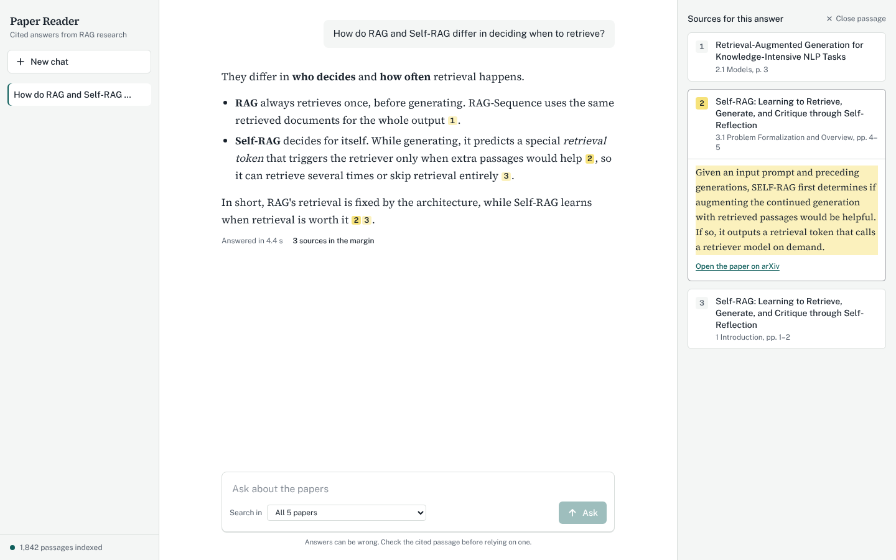

# RAG Chatbot over AI/NLP Research Papers

Ask questions about 15 landmark papers (Transformers, BERT, DPR, ColBERT, RAG, Self-RAG,
CRAG, GraphRAG, RAGAS, …) and get answers with citations to the paper, section and page.
Follow-up questions work: the conversation is taken into account.

**Status:** Phase 4 complete. Hybrid retrieval with reranking, orchestrated as a LangGraph
pipeline (query rewriting, relevance grading, one retry), served by a streaming FastAPI backend,
measured with four evaluation sets, and used through a Next.js chat UI with accounts,
saved chats and LangSmith tracing.



## How it works

**Indexing**

```
PDFs ──► unstructured (partition + chunk by section) ──► OpenAI embeddings ──┐
                                                          BM25 (in Qdrant) ──┴──► Qdrant
```

**Answering a question** (LangGraph)

```
question + history
   │
   ▼
rewrite ─┬─ chat ──────► small_talk ──► short reply, no search ("hi", "thanks", "what can you do?")
(routes) ├─ off_topic ─► abstain ─────► "I don't know…" without searching
         └─ papers ────► retrieve ──► grade ──┬── relevant chunks ─────────────► generate ──► cited answer
                           ▲                  ├── nothing relevant, retry left ─► reformulate ─┐
                           └──────────────────┼────────────────────────────────────────────────┘
                                              └── nothing relevant, no retry ───► abstain ───► "I don't know…"
```

| Step | What it does | Why |
|---|---|---|
| **rewrite** | Routes every message: paper question, small talk, or off-topic. For follow-ups, the same call turns "How is it trained?" into "How is Self-RAG trained?". A first message needs one small routing call. | Small talk used to be searched like a question ("hi" once came back as an answer about HyDE); off-topic questions paid for a search and a retry before being refused. Retrieval only sees one message, so follow-ups must be made standalone. |
| **small_talk** | A short friendly reply that says what the bot can do, without searching or stating facts. | Greetings and thanks aren't questions about the papers. |
| **retrieve** | Hybrid search (dense + BM25, fused with RRF), 20 candidates reranked by a cross-encoder to the top 5. | Dense search misses rare terms (CRAG, MaxSim); the reranker fixes the ordering. |
| **grade** | One LLM call keeps only the chunks that actually help answer the question, judged against the user's (standalone) question, never a retry's search query. | Stops wrong-paper chunks (e.g. CRAG's appendix mentioning Self-RAG) from reaching the answer, and stops a drifting retry from changing the topic. |
| **reformulate** | If nothing is relevant, writes one different search query and retrieves again (max 1 retry). | Gives missed questions a second chance at bounded cost. |
| **generate / abstain** | Answers from the graded chunks with `[n]` citations, corrects false premises, or refuses without an LLM call. | Grounded answers; honest refusals when the papers don't cover the question. |

Every LLM step falls back safely: a failed routing call searches as before, a failed rewrite
uses the original question, a failed grade keeps all chunks, a failed reformulation retries with
the original question, a failed small-talk reply uses a default one.

## Results

Three golden sets: **retrieval** (33 questions), **generator** (43 questions incl. false premises
and unanswerable ones) and **multi-turn** (14 conversations). Judge: `gpt-4o-mini` via DeepEval.

**Retrieval** (30 answerable questions)

| Setup | Contextual precision | Contextual recall | Retrieval p50 |
|---|---|---|---|
| Baseline: BGE dense | 0.708 | 0.956 | — |
| OpenAI hybrid (dense + BM25) | 0.838 | 0.936 | — |
| **OpenAI hybrid + reranker** | **0.881** | **0.969** | 1.3 s |

**Generator** (33 questions that should be answered)

| Setup | Faithfulness | Answer relevancy | Correct behavior | False refusals |
|---|---|---|---|---|
| Baseline (first prompt) | 0.899 | 0.843 | — | 5 |
| Hybrid + rerank, new prompt | 0.902 | 0.966 | 0.715 | 1 |
| **Full graph** | **0.928** | 0.948 | 0.703 | 1 |

Unanswerable questions are refused 4/4 in every setup since the prompt fix. Through the graph,
2 of 43 questions needed the retry step; grading lifts faithfulness (0.902 → 0.928) because
irrelevant chunks no longer reach the generator.

**Multi-turn** (14 conversations; the same follow-up sent with and without the earlier turns)

| | Paper hit | Recall | Correct behavior | Rewrite quality |
|---|---|---|---|---|
| Without history | 0.62 | 0.54 | 0.54 | — |
| **With history (rewriting)** | **1.00** | **0.96** | **0.82** | 0.90 |

**Latency** (full graph on a laptop)

| Questions | p50 | p95 |
|---|---|---|
| Paper questions (33) | 4.4 s | 5.7 s |
| Off-topic (grade → retry → abstain) | 5.5 s | 6.0 s |

Retrieval with reranking takes ~1.3 s of this; grading and generation are `gpt-4o-mini` calls.
`/chat/stream` sends the sources as soon as grading finishes and then streams the answer,
so users see output well before the full time. These numbers predate the router: off-topic
questions are now refused after one small routing call instead of a search and a retry, and
first messages pay that call (~0.3–0.5 s) before searching. Re-run `scripts/bench_latency.py --graph`.

**Known limitations**
- False premises in single questions are corrected only 1 in 4 times (`gpt-4o-mini` tends to refuse).
- Ambiguous questions ("How is the relevance score computed?") are not clarified.
- Comparisons sometimes retrieve only one side (DPR vs ColBERT).
- One detail-level miss (RAG's "21 million documents") in every setup.

Details and per-question notes: [`eval/phase3_comparison.md`](eval/phase3_comparison.md),
[`eval/retrieval_eval_notes.md`](eval/retrieval_eval_notes.md),
[`eval/generator_eval_notes.md`](eval/generator_eval_notes.md).

### Design decisions backed by the evals
- **Hybrid + reranker as default:** best precision and recall of all setups, for ~1.3 s per query.
- **No paper filter from the rewrite:** it looked useful, but in the multi-turn eval a wrong guess
  hid the answer twice and hybrid + rerank found the right paper without it in every case.
  It's still available behind `REWRITE_PAPER_FILTER=true`.
- **One retry, not more:** enough to recover missed questions; each retry adds an LLM call and
  a search, which off-topic questions pay for before being refused.

## Stack

Python 3.12 · uv · unstructured · OpenAI (`text-embedding-3-small`, `gpt-4o-mini`) · Qdrant
(dense + BM25, RRF) · sentence-transformers cross-encoder (`BAAI/bge-reranker-base`) ·
LangGraph · FastAPI · Postgres (SQLAlchemy 2, Alembic) · argon2 + JWT auth · LangSmith · DeepEval · pytest · Next.js 16 (React 19, TypeScript, Tailwind v4) · Vitest

## Setup

```bash
git clone <repo-url> && cd rag-chatbot
uv sync
cp .env.example .env                      # add OPENAI_API_KEY; set RETRIEVAL_MODE=hybrid, RERANK=true
docker run -d -p 6333:6333 -v qdrant_data:/qdrant/storage --name qdrant qdrant/qdrant   # Qdrant >= 1.15.3
docker run -d -p 5432:5432 -e POSTGRES_USER=rag -e POSTGRES_PASSWORD=rag -e POSTGRES_DB=rag \
  -v pg_data:/var/lib/postgresql/data --name postgres postgres:17                       # chat history
uv run alembic upgrade head               # create the users and chat-history tables
# set JWT_SECRET in .env (see .env.example), or everyone is signed out on each restart

uv run python scripts/download_papers.py  # 15 PDFs from arXiv → data/raw/
uv run python scripts/ingest.py           # chunk, embed, load into Qdrant (--force to rebuild)
```

## Usage

```bash
uv run python scripts/try_graph.py                    # run the full graph: a question, a follow-up, edge cases
uv run python scripts/try_graph.py --diagram          # print the graph as Mermaid
uv run python scripts/try_retrieval.py "What is late interaction in ColBERT?"   # inspect retrieved chunks
uv run python scripts/inspect_chunks.py 2005.11401.pdf                          # check chunking for one paper
```

## Chat UI

```bash
cd frontend && npm install && npm run dev          # http://localhost:3000 (the API must be running)
```

A Next.js app that streams answers from `/chat/stream`. Each `[n]` citation is a clickable
mark that opens the cited passage in a side margin. You sign in with an email and password,
and your chats are saved to your account in Postgres. Details in [frontend/README.md](frontend/README.md).

## API

```bash
uv run uvicorn rag.api.main:app --app-dir src --reload     # interactive docs: http://localhost:8000/docs
```

| Method | Path | What it does |
|---|---|---|
| GET | `/health` | Qdrant reachable + number of indexed chunks (`ok` / `degraded`), and whether the database is up |
| GET | `/papers` | The indexed papers (for the UI's paper filter) |
| POST | `/search` | Retrieved chunks only, no LLM call |
| POST | `/chat` | Full cited answer as JSON (runs the graph) |
| POST | `/chat/stream` | Streamed answer via Server-Sent Events: `sources` → `token`… → `done` |
| POST / GET | `/ingest` | Start background ingestion / check its status |
| POST | `/auth/signup`, `/auth/login` | Create an account / sign in: sets an httpOnly session cookie |
| POST / GET | `/auth/logout`, `/auth/me` | Sign out / who is signed in |
| GET / POST | `/conversations` | List your saved chats (newest first) / start one |
| GET / PATCH / DELETE | `/conversations/{id}` | One of your chats with its messages / rename / delete |

`/health` and `/papers` are public; everything else needs a signed-in user (401 otherwise).

For a saved chat, send `conversation_id`: the server loads the history from Postgres and stores
both turns (a stopped answer is kept, marked `stopped`). Without it, send earlier turns in `history`
yourself. Responses include `rewritten_query` and `retries`:

```bash
curl -s -X POST localhost:8000/chat -H "Content-Type: application/json" -d '{
  "question": "How is it trained?",
  "history": [{"role": "user", "content": "What is Self-RAG?"},
              {"role": "assistant", "content": "Self-RAG trains a model to decide when to retrieve..."}]
}' | python -m json.tool
```

Errors: `401` not signed in · `404` unknown conversation (or someone else's) · `429` too many failed sign-ins · `422` invalid input · `502` LLM provider failed · `503` vector store unavailable · `409` ingestion already running.

## Auth

Email and password, built into the API:

- **Passwords** are stored as argon2 hashes (`pwdlib`), never as text. Signing in with an unknown
  email does the same hashing work as a wrong password, so response times don't reveal accounts.
- **Sessions** are JWTs signed with `JWT_SECRET`, in an httpOnly, SameSite=Lax cookie: page scripts
  can't read it and other sites can't use it. Scripts can send `Authorization: Bearer <token>`.
- **Authorization:** every chat query filters by the owner. Someone else's chat returns 404, exactly
  like a missing one, so ids can't be probed.
- **Brute force:** 5 failed sign-ins per email and IP in 15 minutes → 429 (in memory, per process).

`rag/auth.py` has the hashing, tokens, the `current_user` dependency and the limiter; routes are
protected with `user: User = Depends(current_user)`. Chats saved before auth existed have no owner
and can't be opened (delete them with `DELETE FROM conversations WHERE user_id IS NULL;`).

## Tracing (LangSmith)

Set `LANGSMITH_TRACING=true`, `LANGSMITH_API_KEY` and `LANGSMITH_PROJECT` in `.env`. Each chat
turn then becomes one trace:

```
chat_stream                      metadata: conversation_id, user_id, top_k, retrieval_mode, rerank, llm_model
├── LangGraph
│   ├── rewrite ── ChatOpenAI    (routes; also rewrites follow-ups)
│   ├── retrieve
│   ├── grade ──── ChatOpenAI
│   └── route_after_grade
└── generate ───── ChatOpenAI    (streamed; prompt, answer, tokens, cost)
```

LangGraph traces the nodes by itself; `wrap_openai` traces every LLM call; `rag/tracing.py`
groups a turn under one parent run. Turns share `conversation_id`, so a chat shows up as a
thread. Tests force tracing off (`tests/conftest.py`).

## Testing and evaluation

```bash
uv run pytest -q                                   # 82 tests: API + graph, all external services faked
(cd frontend && npm test)                          # 10 UI unit tests: SSE parser, citations, saved chats
uv run python eval/eval_retriever.py               # contextual precision & recall
uv run python eval/eval_generator.py               # faithfulness, relevancy, correct behavior (through the graph)
uv run python eval/eval_multiturn.py               # follow-ups, with vs without history
uv run python eval/eval_router.py                  # routing: papers / small talk / off-topic (no Qdrant needed)
uv run python scripts/bench_latency.py --graph     # full-graph latency
bash scripts/run_eval.sh hybrid+rerank             # ingest + latency + retrieval & generator evals for a setup
```

## Project structure

```
src/rag/
  config.py            settings from .env (retrieval mode, reranker, retries, ...)
  embeddings.py        OpenAI or local (BGE) embeddings
  vectorstore.py       Qdrant: dense or hybrid (dense + BM25) collections and search
  rerank.py            cross-encoder reranker
  retrieval.py         question → ranked chunks with citations
  generation.py        prompts + LLM → cited answer (also streaming)
  prompts/             system rules, answer template, rewrite, grade, reformulate
  graph/
    state.py           shared graph state
    nodes.py           rewrite, retrieve, grade, reformulate, generate, abstain
    build.py           graph wiring (full graph + retrieval-only graph for streaming)
  db/
    models.py          users, conversations, messages tables (SQLAlchemy)
    session.py         engine and per-request session
    repo.py            chat-history queries
  auth.py              passwords, session tokens, current_user, login limiter
  tracing.py           LangSmith: one trace per chat turn
  api/
    main.py            FastAPI routes
    schemas.py         request / response models
  ingestion/
    chunker.py         PDF → section-aware chunks + metadata
    pipeline.py        PDFs → chunks → vectors → Qdrant
scripts/               download, ingest, try the graph, retrieval checks, latency, eval runner
eval/                  four eval scripts (retrieval, generator, multi-turn, router) + notes
goldens/               retrieval, generator, multi-turn and router golden sets
tests/                 API, graph, chat-history, auth and tracing tests
migrations/            Alembic migrations: chat history, then users and chat owners
frontend/              Next.js chat UI (see frontend/README.md)
  app/                 layout, page, global styles
  components/          Chat, Answer, SourceList, Composer, Sidebar, ...
  lib/                 API client, SSE parser, citation linking, storage
```

## Roadmap

- [x] **Phase 1**: ingestion, retrieval, cited generation, evaluated baseline
- [x] **Phase 2**: FastAPI backend with streaming answers
- [x] **Phase 3**: hybrid search + reranking, LangGraph (rewrite, grade, retry), multi-turn chat, three eval sets
- [x] **Phase 4**: Next.js chat UI, chat history (Postgres), auth, tracing (LangSmith)
  - [x] Chat UI: streaming answers, clickable citations, paper filter, browser-saved history
  - [x] Server-side chat history (Postgres, Alembic migrations)
  - [x] Auth (email + password, JWT cookie, per-user chats)
  - [x] Tracing (LangSmith)
- [ ] **Phase 5**: Docker Compose, CI with eval gates, guardrails, cloud deployment

> Answers come from the papers in `data/raw` only and may be incomplete. Not a substitute for reading the papers.
